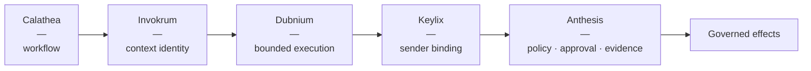

<h1 align="center">RJ</h1>

  <strong>Senior / Staff / Principal Software Engineer</strong> 
  Platform & backend architecture · Native mobile · Application security · Governed AI

  <a href="https://micrantha.com">micrantha.com</a> ·
  <a href="https://ryanjennin.gs">ryanjennin.gs</a> ·
  <a href="mailto:rybertjen@gmail.com">email</a>

---

I build long-lived software systems where **correctness, security, operability, and explicit trust boundaries** matter.

My commercial experience spans 15+ years of Android, iOS, React Native, backend integrations, platform delivery, modernization, and security-sensitive engineering. My independent/open-source work extends that foundation into Kotlin Multiplatform, Rust/Go developer tools, local-first AI infrastructure, and governed agentic systems. The common thread is **maintainable architecture, explicit trust boundaries, and independently verifiable outcomes**.

The recurring question behind much of my current work is:

> How do autonomous systems become more capable without quietly accumulating unchecked authority?

## Current focus

- **Governed agentic systems** — policy, capabilities, approvals, evidence, provenance, replay, and bounded side effects.
- **AI-native SDLC** — treating agents as constrained delivery participants rather than trusted autocomplete or autonomous maintainers.
- **Context integrity** — deterministic prompt/context composition, manifests, lockfiles, provenance, and reproducible agent inputs.
- **Agent identity & authorization** — sender-constrained OAuth, proof-of-possession, replay resistance, and MCP security boundaries.
- **Local-first AI infrastructure** — model routing, supervisor/specialist agents, memory, evaluation, scheduling, and secure execution on self-hosted infrastructure.
- **Platform & developer experience** — paved paths, strong contracts, predictable failure modes, observability, CI/CD, and incremental modernization.

A principle I keep returning to: **a system may propose its successor, but it should not independently authorize the transition to that successor.** Durable state changes need an external trust boundary and evidence that can be independently evaluated.

## Engineering evidence by role

My commercial work covers long-lived mobile/client applications, backend integrations, modernization, release engineering, and security-sensitive delivery. The projects below are **independent/open-source engineering**, except for explicitly identified collaborative work such as OpenArchive. They demonstrate design and implementation decisions, not unverified employer-scale adoption.

| Area | Start here |
| --- | --- |
| **Staff / platform / backend** | [Config Drift Guard](https://github.com/ryjen/config-drift-guard), [Repora](https://github.com/hackelia-micrantha/repora), [TidyFS](https://github.com/ryjen/tidyfs) — deterministic state, failure and recovery, governed mutation |
| **Mobile / native / cross-platform** | [Public OpenArchive Android commits](https://github.com/OpenArchive/Save-app-android/commits?author=ryjen), [Eyespie](https://github.com/ryjen/eyespie), [Amaryllis](https://github.com/hackelia-micrantha/amaryllis) — native platform boundaries, offline-first state, on-device inference |
| **AppSec / AI governance / DevEx** | [Anthesis Governance Lab](https://github.com/ryjen/anthesis-governance-lab), [Keylix](https://github.com/hackelia-micrantha/keylix-community), [git-autocommit](https://github.com/ryjen/git-autocommit) — fail-closed decisions, sender binding, untrusted AI output |

**[Read engineering case studies with problem, design, verification, and limitations →](docs/engineering-work.md)**

## Selected engineering work

| System | Engineering evidence |
| --- | --- |
| **[Anthesis](https://github.com/hackelia-micrantha/anthesis-community)** and **[Governance Lab](https://github.com/ryjen/anthesis-governance-lab)** | Governed agent effects, explicit authority boundaries, executable adversarial/conformance trials; runtime enforcement remains integration-dependent. |
| **[Config Drift Guard](https://github.com/ryjen/config-drift-guard)** | Deterministic control-plane reconciliation, immutable approval plans, stale-state rejection, SQLite workflow persistence, and an operator UI. |
| **[Repora](https://github.com/hackelia-micrantha/repora)** | Go repository control, explicit plans, safe ref reconciliation, and durable execution evidence (experimental). |
| **[Eyespie](https://github.com/ryjen/eyespie)** | Kotlin Multiplatform offline-first mobile computer vision, native Android/iOS integration, signed game interchange, and exact-candidate release verification; physical acceptance is still open. |
| **[TidyFS](https://github.com/ryjen/tidyfs)** | Rust filesystem analysis and reversible cleanup, recovery and adversarial validation, with AI limited to advisory decisions. |
| **[Amaryllis](https://github.com/hackelia-micrantha/amaryllis)** | React Native/on-device multimodal inference and schema-constrained component integration. |

Additional work: **[Hyperion Community](https://github.com/hackelia-micrantha/hyperion-community)** (infrastructure/GitOps), **[Keylix Community](https://github.com/hackelia-micrantha/keylix-community)** (OAuth/DPoP sender binding), **[Seamwork](https://github.com/ryjen/seamwork)** (modern C++23 interface studies), **[Shopping Inventory](https://github.com/ryjen/shopping-inventory)** (private data, public implementation and deterministic evidence), and **[git-autocommit](https://github.com/ryjen/git-autocommit)** (bounded AI-assisted Git commits).

## Research and engineering practice

- **[Secure Agent Workflows](https://github.com/ryjen/agent-delivery-playbook)** — secure AI-assisted delivery patterns, task boundaries, threat modeling, and review evidence.
- **[Micrantha engineering contracts](https://github.com/hackelia-micrantha/.github)** — shared secure-SDLC, testing, CI/CD, repository and release standards, with no blanket certification implied.
- **[Personal technical work](https://github.com/ryjen/guitar-practice-system)** — music tooling, guitar/DSP experiments and local-first projects.

Historical repositories remain available for context; archived examples do not imply current support or current engineering style.

## Micrantha / governed agent stack

A set of deliberately separated projects exploring those boundaries:

| Project | Role |
| --- | --- |
| **[Anthesis](https://anthesis.micrantha.com)** | Deterministic governance boundary for consequential agentic effects: policy, approval, capabilities, evidence, provenance, and auditability. |
| **[Invokrum](https://github.com/hackelia-micrantha/invokrum-community)** | Deterministic prompt-overlay composition and attestation: explicit ordering, compatibility, manifests, lockfiles, and reproducible context. |
| **[Keylix](https://github.com/hackelia-micrantha/keylix-community)** | Sender-constrained authorization and proof-of-possession primitives for OAuth, DPoP, MCP, and agentic workloads. |
| **[Dubnium](https://github.com/hackelia-micrantha/dubnium-community)** | Private local-first AI/runtime test bed: supervisor/specialists, model routing, memory, tools, scheduling, runtime evidence, and governed execution. |
| **[Calathea](https://github.com/hackelia-micrantha/calathea-community)** | Workflow/task-contract layer for composing bounded agent work without collapsing orchestration into governance or runtime concerns. |

The goal is not a monolithic agent framework. The interesting work is at the **boundaries**: what context entered the system, who or what is acting, what authority it has, what effect is requested, who approves it, and what evidence remains afterward.

## Engineering perspective

I tend to work best on systems that are already real enough to have constraints:

- production software with users, migrations, compatibility requirements, and operational history;
- security-sensitive authentication, authorization, credential, and trust boundaries;
- platform or developer-experience work that must improve delivery without creating a second platform nobody wants to maintain;
- mobile systems where platform-specific behavior matters and cannot always be abstracted into "just another web client";
- agentic/AI systems where probabilistic reasoning needs deterministic controls around consequential effects.

I prefer incremental modernization over rewrites, explicit contracts over convention, boring cryptography over clever cryptography, and evidence over claims that a system "should" be safe.

## Current goals

I am continuing to turn the Micrantha work into **small, composable, auditable systems and public reference material** for secure agentic software delivery.

Professionally, I am interested in **Staff / Principal engineering and selective contract work** around AI infrastructure, platform engineering, application security, developer experience, secure SDLC, and complex mobile/backend systems — preferably remote-first in Canada.

I am also interested in collaborating on work around:

- agent governance, authorization, observability, and evaluation;
- MCP and agent/tool security;
- secure platform and API design;
- mobile security and device/app trust;
- local/self-hosted AI infrastructure;
- practical research-to-production engineering.

## Outside software

I play guitar and piano, record music, play hockey, and occasionally turn engineering energy toward things that have nothing to do with infrastructure — including **[Entanglement of Ages](https://github.com/ryjen/entanglement-of-ages-marketing)**, a long-form fiction/screenplay project.

he / him
